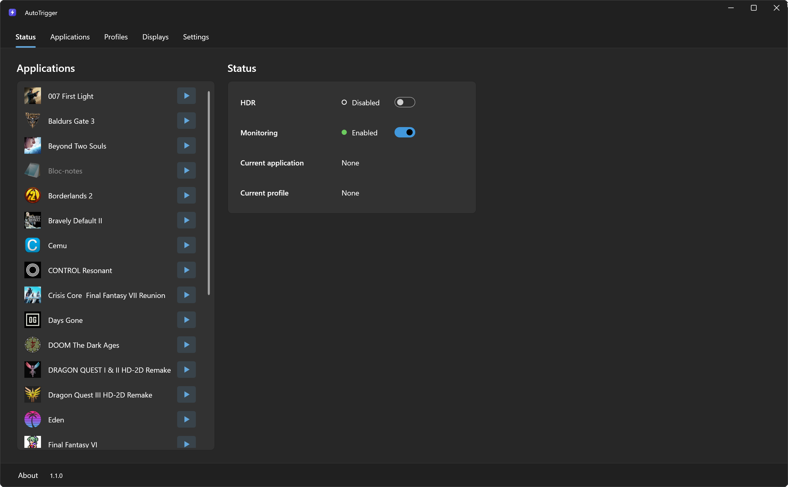
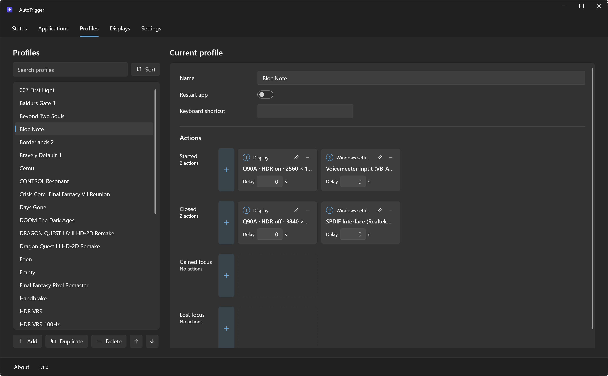
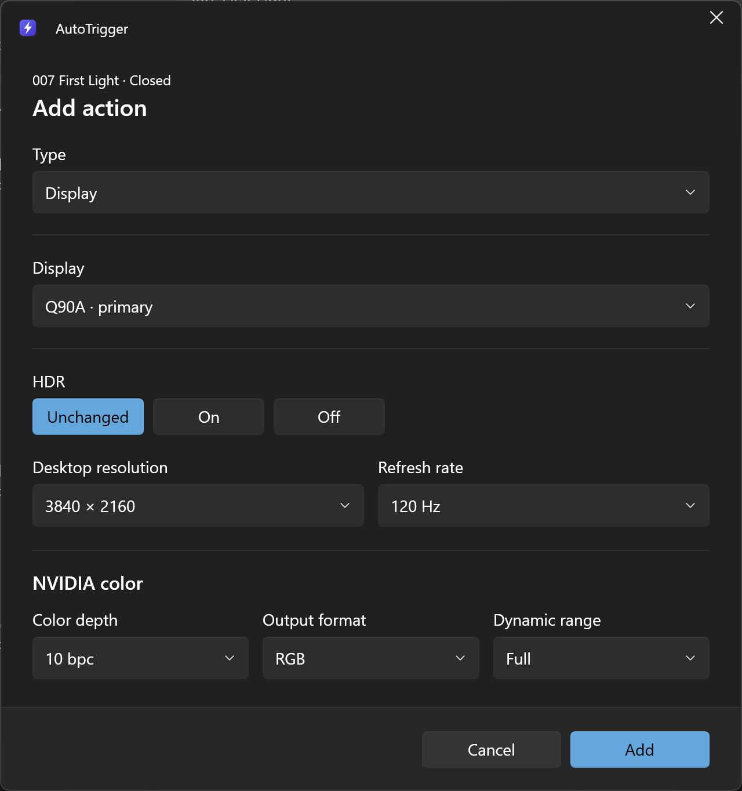
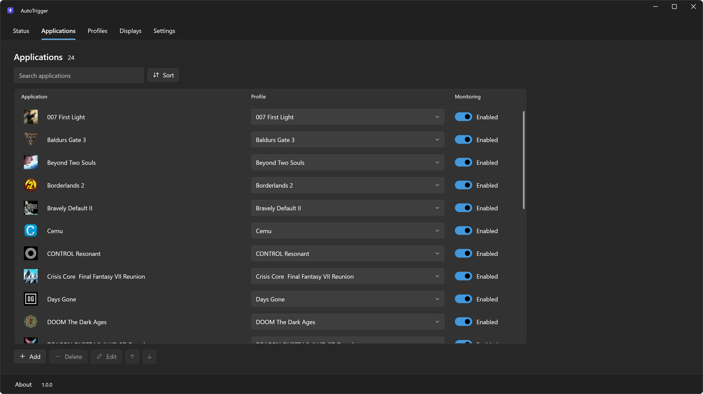
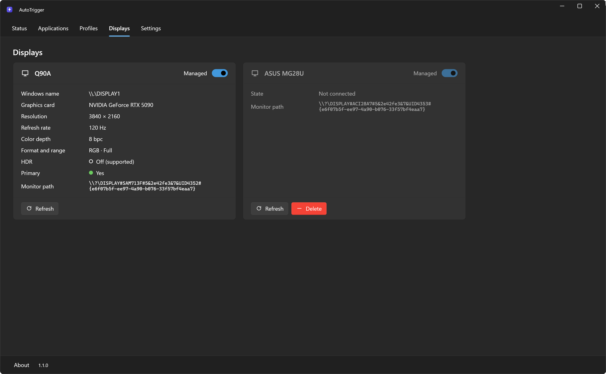
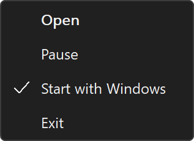

# AutoTrigger

A Windows tray app that runs actions when an application starts, closes, gains or loses focus: switch HDR, change the resolution or refresh rate, pick the audio devices, change the power plan, run or close programs, or press a hotkey.

Inspired by [AutoActions](https://github.com/Codectory/AutoActions) by Codectory. Independent rewrite, not affiliated with Codectory or NVIDIA.



## Features

- Four events per application: Started, Closed, Gained focus, Lost focus.
- Actions, each with its own delay:
  - **Run program** and **Close program**.
  - **Display**: HDR, resolution, refresh rate and, on NVIDIA, color depth, format and range. Works with DSR and DLDSR.
  - **Audio**: default playback and recording devices.
  - **Power plan**: classic Windows power plans.
  - **Press hotkey**: a shortcut of another program, such as an RTSS overlay.
  - **Reference profile**: reuses the actions of another profile.
- Shared profiles, a monitoring switch per application and a global pause.
- Light and dark themes, following Windows by default.
- Import from AutoActions.
- About 0.06 % of one CPU core while idle. No administrator rights, no network access.









## Requirements

- Windows 11 24H2 or later, 64-bit.
- .NET Framework 4.8, included in Windows 11.
- An NVIDIA GPU for color depth, format and range.

## Usage

Download the zip from the Releases page, extract it and run AutoTrigger.exe. The program is not signed: if SmartScreen warns, choose **More info**, then **Run anyway**.

1. **Applications**: add the programs to follow.
2. **Profiles**: add actions to each event, then assign the profile to applications.
3. Leave AutoTrigger in the tray. Double-click opens it; right-click for Open, Pause, Start with Windows and Exit.



### Moving from AutoActions

Settings, **Import from AutoActions**, then pick its `UserSettings.json`. Applications, profiles and displays are replaced; the previous AutoTrigger settings are backed up and AutoActions' file is not changed. Quit AutoActions afterwards, or every action runs twice. AutoActions shortcuts and the default profile are not imported.

### Full path or file name

Applications are matched by full path. Choose **File name only** when the folder changes over time, such as Game Pass games or programs that update into versioned folders.

### Press hotkey limits

- One shortcut per action.
- The window in front receives the keys too.
- Windows blocks hotkeys sent to a window run as administrator.
- No confirmation that the other program reacted; some games and anti-cheat systems ignore simulated keys.

### Log and uninstall

To report a problem, set **Log level** to **Detailed** in Settings, reproduce it, then attach `AutoTrigger.log` (**Open log**).

To uninstall, uncheck Start with Windows, choose Exit, then delete the AutoTrigger folder and `%LOCALAPPDATA%\AutoTrigger`.

## Build

Visual Studio 2026 with the **.NET desktop development** workload, from a Developer Command Prompt:

```
msbuild AutoTrigger.sln -restore -p:Configuration=Release
```

The program is written to `out\Release`. [WPF UI](https://github.com/lepoco/wpfui) 4.3.0 is downloaded from NuGet on the first build.

## How it works

- **Starts**: the process list is read every 500 ms with `NtQuerySystemInformation`. **Closes**: signaled by Windows. **Focus**: a `WinEvent` hook; a change must last 300 ms.
- The actions of an event run one after the other; a delay counts from the start of the previous action.
- **Display**: resolution with `SetDisplayConfig` and GPU scaling, HDR with `DisplayConfigSetDeviceInfo`, NVIDIA color with NVAPI. Only what differs is changed, and a failed step undoes the previous ones.
- **Audio** sets the Windows default devices, **Power plan** uses `PowerSetActiveScheme` and **Press hotkey** uses `SendInput`.
- Settings are in `%LOCALAPPDATA%\AutoTrigger\settings.json`, written atomically. Start with Windows uses the current user's `Run` key. AutoTrigger doesn't use the network.

## AI disclosure

This app was built with the help of AI (Claude, by Anthropic) under the direction of the author.

## License

MIT, see [LICENSE](LICENSE). WPF UI and the .NET libraries are distributed under their MIT licenses and the NVAPI definitions under NVIDIA's MIT license, see [NOTICE.txt](NOTICE.txt).

NVIDIA is a trademark or registered trademark of NVIDIA Corporation.
