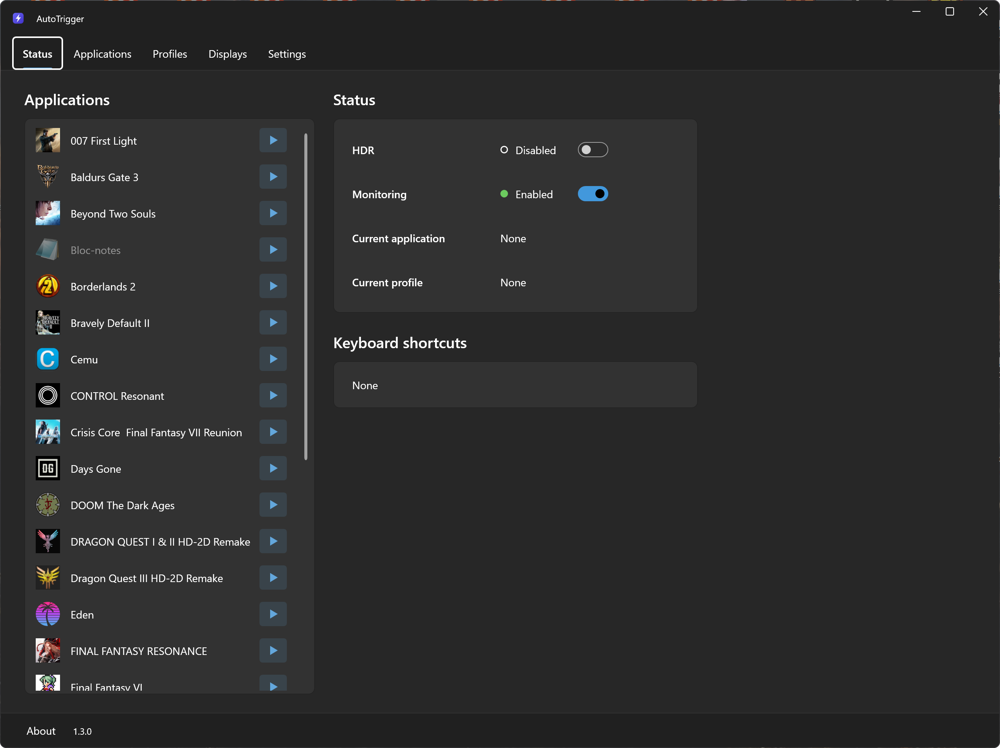
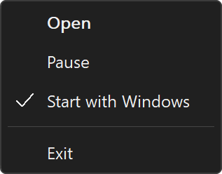
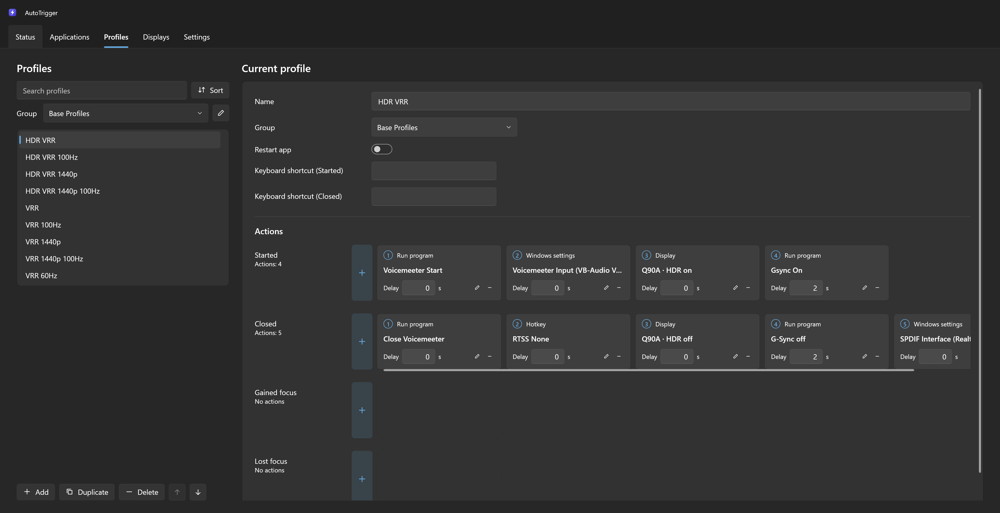
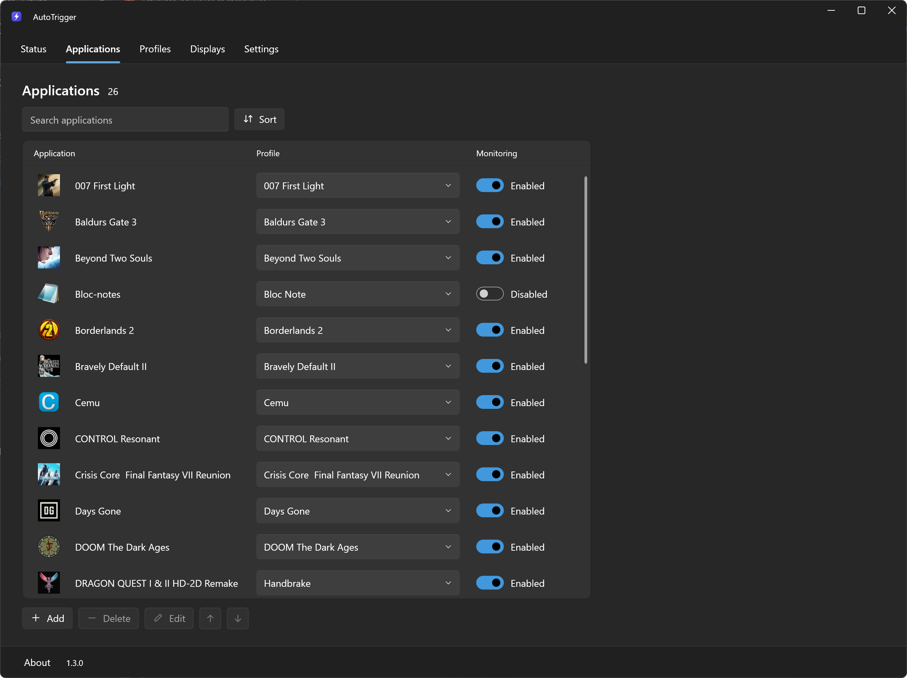
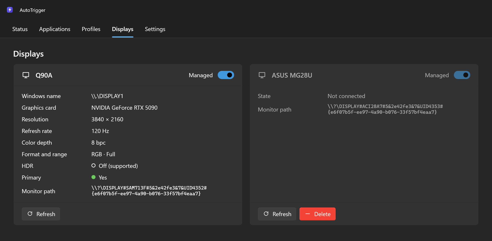
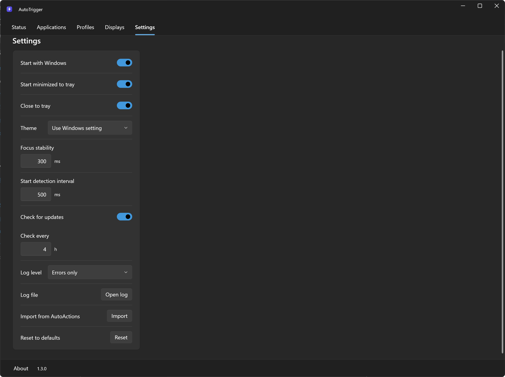
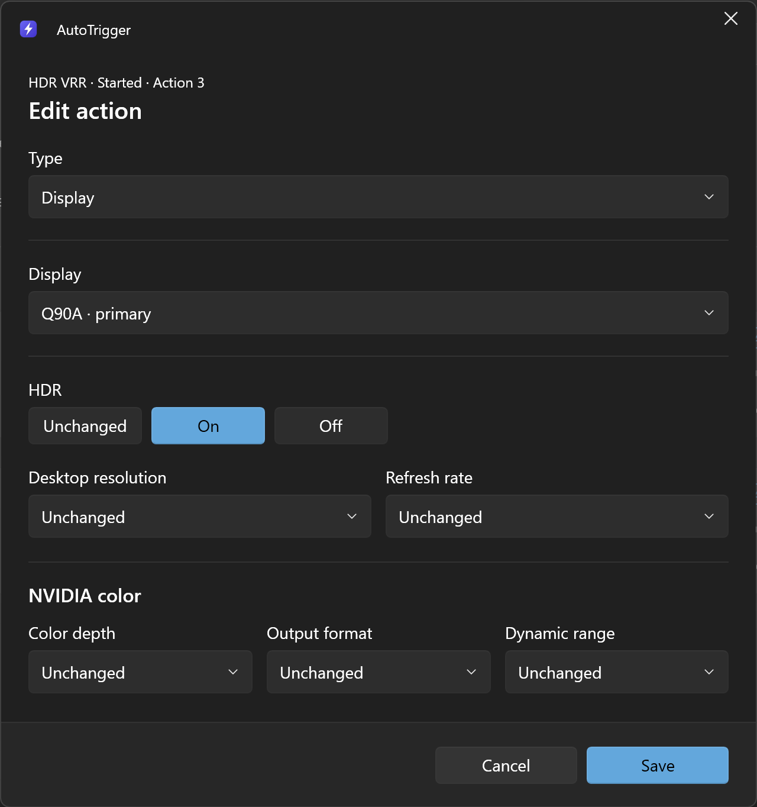
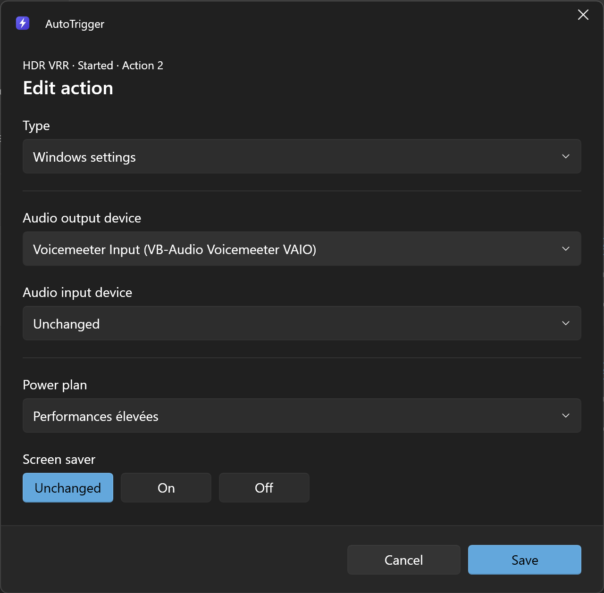
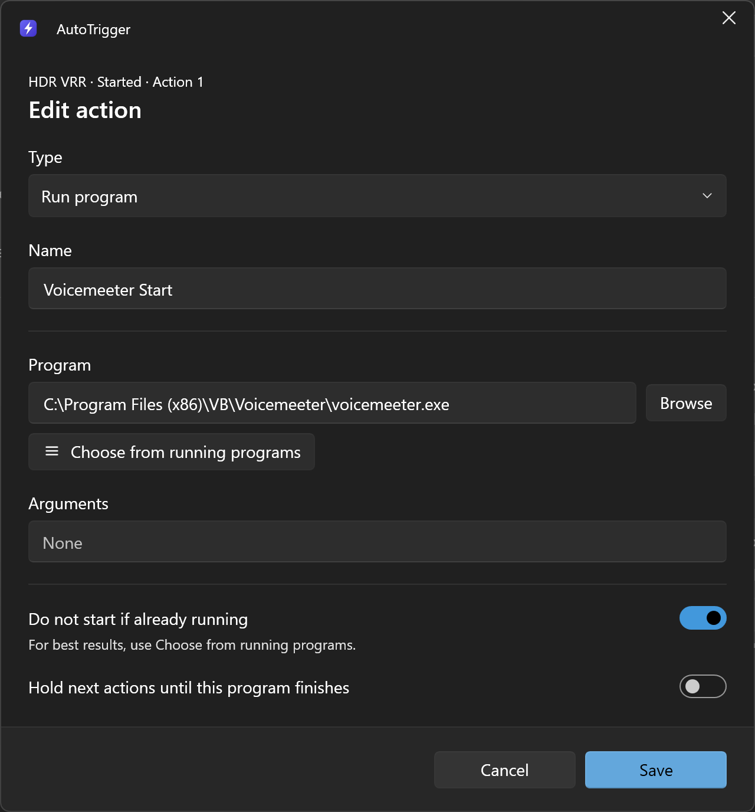
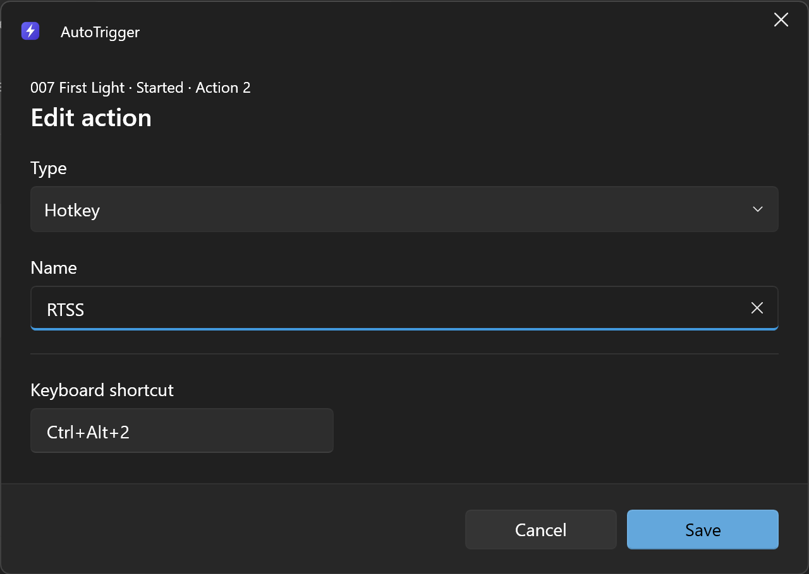

# AutoTrigger

**Automatic Windows HDR, resolution, refresh rate and audio device per game or app, on Windows 10 and 11.**

AutoTrigger is a free, open-source app that sits in the notification area and watches the games and apps you add. When one starts, it changes the Windows settings you chose for it. When it closes, it puts them back.

An alternative to AutoActions: it imports your AutoActions applications, profiles and displays in one step.

## What it does

- Turns Windows HDR on when a game starts, and off when it closes.
- Changes the resolution and refresh rate for a game, DSR and DLDSR included, and on NVIDIA cards the color depth, format and range.
- Switches the default audio output or input, for example to your headset.
- Changes the power plan, and turns the screen saver off while you play with a controller.
- Starts or closes other programs around a game, and can press a keyboard shortcut in another app, for example to switch a mode in an overlay or a recording app.
- Restarts a game after turning HDR on, for games that only check HDR when they start.
- Runs a profile when you want: from a keyboard shortcut, a desktop shortcut, or the Launch button of the Status page, which can also start a game through its launcher with the right display settings first.
- Works with Steam, Epic Games, GOG, Game Pass and other Windows Store apps.
- 37 languages, light and dark themes, and an update check you can turn off.

## Get started

1. Download the zip from the [Releases page](https://github.com/Fr0stX76/AutoTrigger/releases), extract it and run AutoTrigger.exe. Nothing to install: it runs on .NET Framework 4.8, which is part of Windows. The app isn't signed, so if SmartScreen warns, choose **More info**, then **Run anyway**.
2. In **Profiles**, click **Add**. Under **Started**, add a **Display** action with HDR **On**. Under **Closed**, add one with HDR **Off**.
3. Start your game. In **Applications**, click **Add**, use **Choose from running programs** to pick the game, and select your profile.

Next time the game starts, HDR turns on by itself, and it turns off when you quit.

AutoTrigger stays in the notification area: double-click its icon to open the window, right-click it for the menu. The icon gets a dot when an update is out, and changes while monitoring is paused.

 

## Good to know

- **Actions run one after the other.** Each one waits for the previous one to finish, then for its own delay. With a delay of 0, it starts right away.
- When creating a **Run program** or **Close program** action, **Choose from running programs** is recommended for programs that stay open. Use **Browse** for programs that close by themselves, such as scripts. For Windows Store apps and programs that update into a new folder, choose the program again after an update.
- **Do not start if already running** looks for the program itself, not its arguments. Leave it off when an argument is a command, such as a mode for a tool in the notification area or a game link for a launcher: AutoTrigger sees that the program is already open, doesn't start it, and nothing changes.
- An application is recognized by its full path. For Game Pass games and programs that move to a new folder when they update, choose **File name only**.

## Screenshots

 

 

 

 

## FAQ

**How do I turn HDR on automatically for one game?** See [Get started](#get-started): a profile with HDR on in **Started** and off in **Closed**, given to the game.

**My game doesn't see that HDR is on.** Some games read the display settings only when they start. Turn on **Restart app** in the profile: once its **Started** actions are done, AutoTrigger closes the game and starts it again.

**Does it work with Steam, Epic Games, GOG or Game Pass?** Yes. AutoTrigger follows the game's own program, whatever launched it. For Game Pass games, choose **File name only**.

**Can I change settings without starting a game?** Yes. Give the profile a keyboard shortcut, make it the **Launch button** of an application, or create a desktop shortcut. See [Advanced features](#advanced-features).

**My desktop shortcut has no icon.** Import one under **Icon** in the game's window, then create the shortcut again.

**Does it need administrator rights?** No.

**How do I change the language?** In **Settings**, choose **Language**, then **Restart now**.

**Can I keep my AutoActions setup?** Yes, see [Moving from AutoActions](#moving-from-autoactions).

## Advanced features

- **Four events** per application: Started, Closed, Gained focus and Lost focus, to change settings only while its window is in front.
- **Six action types**, each with its own delay: Display, Windows settings, Run program, Close program, Hotkey, and Reference profile to reuse the actions of another profile.
- **Hold next actions** until a program finishes, for example a script that has to end first.
- **Keyboard shortcuts and command line** (`/started`, `/closed`, `/pause`...) to run a profile from anywhere.
- **Launch button and desktop shortcut** for each application, running its program or a profile.
- **Shared profiles**, a monitoring switch per application, and a global pause.
- **Profile groups** for a long list of profiles, and **imported icons** for applications.

The full guide, with how AutoTrigger works under the hood and how to build it: [docs/ADVANCED.md](docs/ADVANCED.md).

## Lightweight and private

- No administrator rights.
- About 0.06 % of one CPU core while idle.
- Portable: one folder, nothing to install. Your settings are one file, `%LOCALAPPDATA%\AutoTrigger\settings.json`.
- The only network access is the update check: one request to GitHub to read the latest version number. Nothing is downloaded or sent, and you can turn it off in **Settings**.
- Open source, under the MIT license.

## Moving from AutoActions

In **Settings**, choose **Import from AutoActions**, then pick its `UserSettings.json`. Your applications, profiles and displays are replaced; AutoTrigger backs up its previous settings and doesn't change AutoActions' file. Quit AutoActions afterwards, or every action runs twice. More in [the guide](docs/ADVANCED.md#moving-from-autoactions).

## Languages

AutoTrigger follows the Windows display language, or the one chosen in **Settings**. It comes in English, French and 35 other languages: Basque, Bulgarian, Catalan, Chinese (Simplified), Chinese (Traditional), Croatian, Czech, Danish, Dutch, Estonian, Finnish, Galician, German, Greek, Hungarian, Indonesian, Italian, Japanese, Korean, Latvian, Lithuanian, Norwegian, Polish, Portuguese (Brazil), Romanian, Russian, Serbian (Latin), Slovak, Slovenian, Spanish, Swedish, Thai, Turkish, Ukrainian and Vietnamese.

English is the reference and the author reviewed French. The other languages were translated with AI, using the words of Windows in each language, and haven't been reviewed by native speakers yet. Corrections are welcome and need no code: see [Translating AutoTrigger](docs/TRANSLATING.md).

## Requirements

- Windows 10 22H2 or Windows 11, 64-bit.
- .NET Framework 4.8, part of Windows 10 22H2 and Windows 11.
- An NVIDIA graphics card for color depth, format and range. Everything else works with any graphics card.

## Report a problem or uninstall

To report a problem, set **Log level** to **Detailed** in **Settings**, make the problem happen again, then attach `AutoTrigger.log` (**Open log**) to your issue. Your user folder appears in it as `%USERPROFILE%`.

To uninstall, uncheck **Start with Windows**, choose **Exit**, then delete the AutoTrigger folder and `%LOCALAPPDATA%\AutoTrigger`.

## Thanks to AutoActions

Thanks to [AutoActions](https://github.com/Codectory/AutoActions) by Codectory, the app that inspired this one. AutoTrigger is a separate program, written from scratch, with no AutoActions code. It reads AutoActions' settings file only to import it, and is not affiliated with Codectory.

## License

MIT, see [LICENSE](LICENSE). WPF UI and the .NET libraries are distributed under their MIT licenses and the NVAPI definitions under NVIDIA's MIT license, see [NOTICE.txt](NOTICE.txt).

NVIDIA is a trademark or registered trademark of NVIDIA Corporation. AutoTrigger is not affiliated with NVIDIA.

## AI disclosure

This app was built with the help of AI (Claude, by Anthropic) under the direction of the author. The translations other than English and French were made with AI, see [Languages](#languages).
