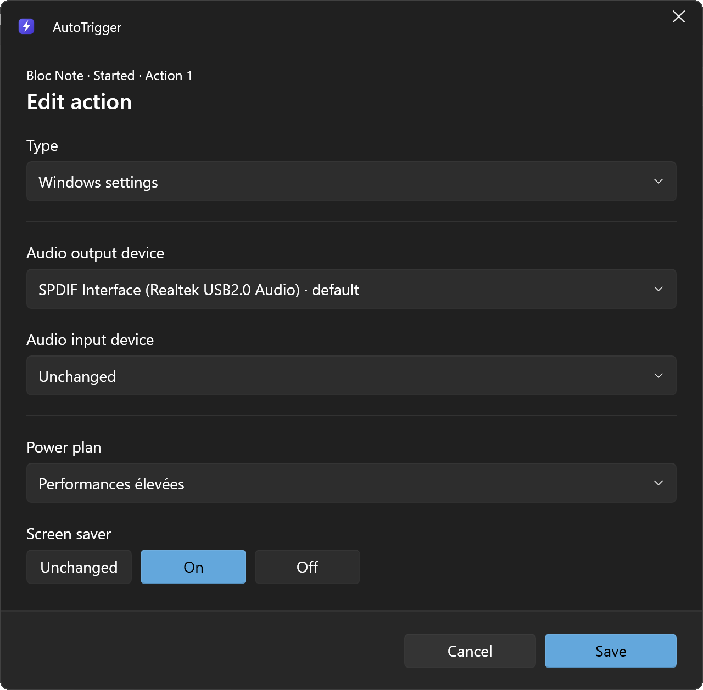
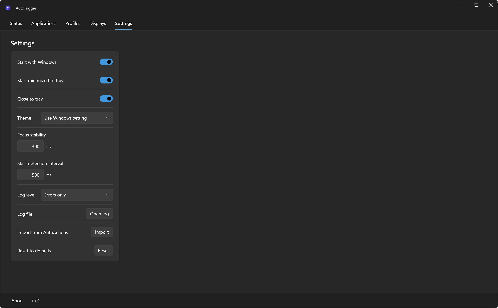

# AutoTrigger

A Windows tray app that runs actions when an application starts, closes, gains or loses focus: switch HDR, change the resolution or refresh rate, pick the audio devices, change the power plan, run or close programs, or press a keyboard shortcut.

Inspired by [AutoActions](https://github.com/Codectory/AutoActions) by Codectory. Independent rewrite, not affiliated with Codectory or NVIDIA.

## Features

- Four events per application: Started, Closed, Gained focus, Lost focus.
- Actions, each with its own delay:
  - **Display**: HDR, resolution, refresh rate and, on NVIDIA, color depth, format and range. Works with DSR and DLDSR.
  - **Windows settings**: default audio output and input devices, power plan, and screen saver on or off for games played with a controller.
  - **Run program** and **Close program**.
  - **Hotkey**: presses a keyboard shortcut of another program, such as an RTSS overlay.
  - **Reference profile**: reuses the actions of another profile.
- Shared profiles, a monitoring switch per application and a global pause.
- Keyboard shortcuts and command line to run the Started or Closed actions of a profile on demand.
- Windows Store apps, focus included.
- Light and dark themes, following Windows by default.
- Import from AutoActions.
- About 0.06 % of one CPU core while idle. No administrator rights, no network access.







## Requirements

- Windows 11 24H2 or later, 64-bit.
- .NET Framework 4.8, included in Windows 11.
- An NVIDIA GPU for color depth, format and range.

## Usage

Download the zip from the Releases page, extract it and run AutoTrigger.exe. The program is not signed: if SmartScreen warns, choose **More info**, then **Run anyway**.

1. **Applications**: add the programs to follow.
2. **Profiles**: add actions to each event, then assign the profile to applications.
3. Leave AutoTrigger in the tray. Double-click opens it; right-click for Open, Pause, Start with Windows and Exit.


### Moving from AutoActions

Settings, **Import from AutoActions**, then pick its `UserSettings.json`. Applications, profiles and displays are replaced; the previous AutoTrigger settings are backed up and AutoActions' file is not changed. The summary lists the programs the imported profiles will start. Quit AutoActions afterwards, or every action runs twice. AutoActions shortcuts and the default profile are not imported.

### Full path or file name

Applications are matched by full path. Choose **File name only** when the folder changes over time, such as Game Pass games or programs that update into versioned folders.

### Keyboard shortcuts and command line

A profile can have two keyboard shortcuts (Ctrl or Alt, with or without Shift, plus a key): **Keyboard shortcut (Started)** runs its **Started** actions and **Keyboard shortcut (Closed)** its **Closed** actions, from anywhere. They also work while monitoring is paused. The Status page lists them all.

| Command | Result |
| --- | --- |
| `AutoTrigger.exe /pause` | Pause monitoring |
| `AutoTrigger.exe /resume` | Resume monitoring |
| `AutoTrigger.exe /toggle` | Pause or resume |
| `AutoTrigger.exe /started "Name"` | Run the Started actions of a profile |
| `AutoTrigger.exe /closed "Name"` | Run the Closed actions of a profile |

AutoTrigger starts if it is not running. Exit code: 0 on success, 1 on failure, 2 for an unknown command.

### Hotkey limits

- One keyboard shortcut per action.
- The window in front receives the keys too.
- Windows blocks keys sent to a window run as administrator.
- If keys are still held down, such as the keyboard shortcut that ran the profile, the action waits up to 1 s for their release.
- No confirmation that the other program reacted; some games and anti-cheat systems ignore simulated keys.

### Log and uninstall

To report a problem, set **Log level** to **Detailed** in Settings, reproduce it, then attach `AutoTrigger.log` (**Open log**). Your user folder appears as `%USERPROFILE%`.

To uninstall, uncheck Start with Windows, choose Exit, then delete the AutoTrigger folder and `%LOCALAPPDATA%\AutoTrigger`.

## Build

Visual Studio 2026 with the **.NET desktop development** workload, from a Developer Command Prompt:

```
msbuild AutoTrigger.sln -restore -p:Configuration=Release
```

The program is written to `out\Release`. [WPF UI](https://github.com/lepoco/wpfui) 4.3.0 is downloaded from NuGet on the first build. The tests are written to `out\Tests`: run `AutoTrigger.Tests.exe`, exit code 0 means they all passed. GitHub builds and tests every change. How the code is organized: [docs/ARCHITECTURE.md](docs/ARCHITECTURE.md).

## How it works

- **Starts**: the process list is read every 500 ms with `NtQuerySystemInformation`. **Closes**: signaled by Windows. **Focus**: a `WinEvent` hook; a change must last 300 ms. For Windows Store apps, the app inside the `ApplicationFrameHost` frame is used.
- The actions of an event run one after the other; a delay counts from the start of the previous action.
- When a profile starts, the profiles still running for another application or a keyboard shortcut finish their remaining actions at once, without their delays, then the new profile runs. This waits 10 s at most.
- **Display**: resolution with `SetDisplayConfig` and GPU scaling, HDR with `DisplayConfigSetDeviceInfo`, NVIDIA color with NVAPI. Only what differs is changed, and a failed step undoes the previous ones.
- **Windows settings** sets the default audio devices and uses `PowerSetActiveScheme` for the power plan. The screen saver is changed for the current session only, and turned back on when AutoTrigger exits. **Hotkey** uses `SendInput`.
- Keyboard shortcuts use `RegisterHotKey`. The command line talks to the running AutoTrigger through a local named pipe open to the current user only.
- Settings are in `%LOCALAPPDATA%\AutoTrigger\settings.json`, written atomically. Start with Windows uses the current user's `Run` key. AutoTrigger doesn't use the network.

## AI disclosure

This app was built with the help of AI (Claude, by Anthropic) under the direction of the author.

## License

MIT, see [LICENSE](LICENSE). WPF UI and the .NET libraries are distributed under their MIT licenses and the NVAPI definitions under NVIDIA's MIT license, see [NOTICE.txt](NOTICE.txt).

NVIDIA is a trademark or registered trademark of NVIDIA Corporation.
