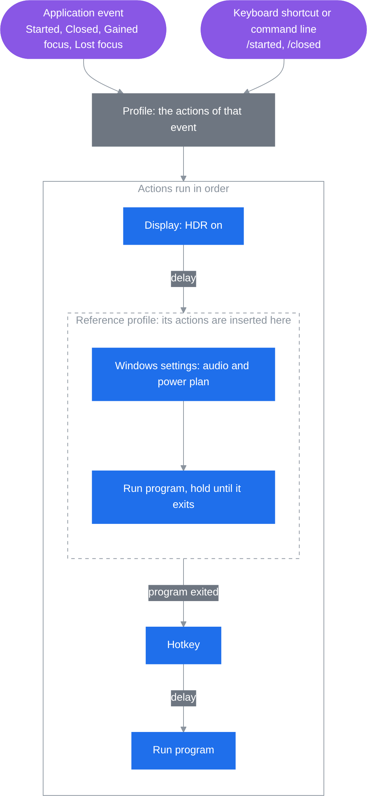
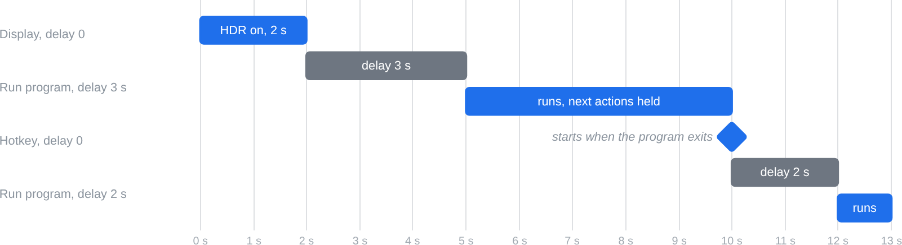

# AutoTrigger

**Automatic HDR, resolution, refresh rate and audio switching per game or app on Windows 10 and 11.**

AutoTrigger is a free, open-source tray app that changes Windows settings when a game or app starts, and sets them back when it closes. Turn HDR on for a game and off on the desktop, change the resolution or refresh rate, switch the default audio device, change the power plan, start or close other programs, or press a keyboard shortcut of another app.

**An AutoActions alternative**: it imports the applications, profiles and displays of AutoActions in one step. Inspired by [AutoActions](https://github.com/Codectory/AutoActions) by Codectory; independent rewrite, not affiliated with Codectory or NVIDIA.


## Use cases

- Turn HDR on automatically when a game starts, and off when it closes.
- Restart a game after turning HDR on, when the game only checks HDR at launch.
- Use a different resolution or refresh rate for games and for the desktop, DSR and DLDSR included.
- Switch the default audio output or input per game or app, for example to a headset.
- Use the High performance power plan while a game, a video encoder or a 3D app runs, and a power saving plan afterwards.
- Turn the screen saver off for games played with a controller.
- Start helper programs before a game or app and close them after it.
- Change settings when an app gains the focus, and set them back when you switch to another window.
- Press a keyboard shortcut of another app when a game starts, for example to switch a mode in an overlay or a recording app.
- Run the actions of a profile on demand, from a keyboard shortcut, a desktop shortcut or the Status page, without waiting for an app to start.
- Start a game from the Status page through a profile, for example through its launcher, with the right display settings first.

## Features

- Four events per application: Started, Closed, Gained focus, Lost focus.
- Actions, each with its own delay:
  - **Display**: HDR, resolution, refresh rate and, on NVIDIA, color depth, format and range. Works with DSR and DLDSR.
  - **Windows settings**: default audio output and input devices, power plan, and screen saver on or off.
  - **Run program**, with options to hold the next actions until it finishes, to hide the console window of command-line tools and scripts, and not to start a program that is already running.
  - **Close program**: asks a program to close, and can force it after a delay.
  - **Hotkey**: presses a keyboard shortcut of another app.
  - **Reference profile**: reuses the actions of another profile.
- An optional name for Run program, Close program and Hotkey actions, shown on the action card and in the log.
- Shared profiles, a monitoring switch per application and a global pause.
- **Restart app**: once the Started actions are done, the program is closed and started again with the same arguments, for games that read HDR or the resolution only when they start.
- Keyboard shortcuts and command line to run the Started or Closed actions of a profile on demand.
- **Launch button** on the Status page, per application: starts its program or runs the Started actions of a profile. A desktop shortcut can do the same.
- Windows Store apps, focus included.
- Light and dark themes, following Windows by default.
- 37 languages, following the Windows display language by default, see [Languages](#languages).
- Import from AutoActions.
- Update check: a link at the bottom of the window and a dot on the tray icon when a new version is out.
- About 0.06 % of one CPU core while idle. No administrator rights. The only network access is the update check, which can be turned off.


 

 


## How actions run

<!-- Diagram sources are in docs/diagrams, rendered to images/ with the Mermaid CLI (mmdc), transparent background, scale 2. -->

An event of an application, a keyboard shortcut or a command picks a profile; the actions of that event then run one after the other.



When each action starts, with the delay set on each one:



- Each action waits for the previous one to finish, then for its own delay: above, Run program starts 3 s after the 2 s display change has ended. With a delay of 0, an action starts as soon as the previous one has finished.
- **Do not start if already running** looks for the program itself, not its arguments. Leave it off for a launcher that opens a game, such as Steam with a game link: the launcher is usually open already, so the game would not start.
- **Hold next actions until this program finishes** makes the next actions wait for that program to exit, 30 s at most by default (**Stop holding after**). The delay of the next action then counts from the end of the hold.
- **Reference profile** inserts the actions of another profile for the same event, with their delays, as if they were written in its place. References can be nested 8 levels deep.
- When a profile starts, the profiles still running for another application or a keyboard shortcut finish their remaining actions at once, without their delays and holds, then the new profile runs. This waits 10 s at most.

## Languages

AutoTrigger uses the Windows display language, or the language chosen in **Settings**. It is available in English, French and 35 other languages: Basque, Bulgarian, Catalan, Chinese (Simplified), Chinese (Traditional), Croatian, Czech, Danish, Dutch, Estonian, Finnish, Galician, German, Greek, Hungarian, Indonesian, Italian, Japanese, Korean, Latvian, Lithuanian, Norwegian, Polish, Portuguese (Brazil), Romanian, Russian, Serbian (Latin), Slovak, Slovenian, Spanish, Swedish, Thai, Turkish, Ukrainian and Vietnamese.

English is the reference and the author reviewed French. The other languages were translated with AI, using the words of Windows in each language, and have not been reviewed by native speakers yet. Corrections are welcome and need no code: see [Translating AutoTrigger](docs/TRANSLATING.md).

## Requirements

- Windows 10 22H2 or Windows 11, 64-bit.
- .NET Framework 4.8, included in Windows 10 22H2 and Windows 11.
- An NVIDIA GPU for color depth, format and range.

## Usage

Download the zip from the Releases page, extract it and run AutoTrigger.exe. The program is not signed: if SmartScreen warns, choose **More info**, then **Run anyway**.

1. **Applications**: add the programs to follow.
2. **Profiles**: add actions to each event, then assign the profile to applications.
3. Leave AutoTrigger in the tray. Double-click opens it; right-click for Open, Pause, Start with Windows and Exit.


### Moving from AutoActions

Settings, **Import from AutoActions**, then pick its `UserSettings.json`. Applications, profiles and displays are replaced; the previous AutoTrigger settings are backed up and AutoActions' file is not changed. The summary lists the programs the imported profiles will start. Quit AutoActions afterwards, or every action runs twice. AutoActions shortcuts and the default profile are not imported; an action type AutoTrigger does not know is kept as an unknown action, which does nothing.

### Full path or file name

Applications are matched by full path. Choose **File name only** when the folder changes over time, such as Game Pass games or programs that update into versioned folders.

### Launch button

The **Launch button** column, in Applications, sets what the Launch button of the Status page runs: **None**, no button; **Program**, the application's own program; or a profile, whose Started actions run as with its keyboard shortcut. A profile with a **Run program** action can start a game through its launcher. Applications added by hand start with None; imported applications and those of earlier versions start with Program.

Right-click an application on the Status page, then **Create desktop shortcut**: the shortcut runs what its Launch button runs, with the program's icon. For **Program**, it opens the program itself; for a profile, it calls `AutoTrigger.exe /launch`, so choosing another profile later needs no new shortcut. Creating it again replaces it; a shortcut of the same name that runs something else is kept, and the new one gets a number.

A shortcut that runs a profile points to AutoTrigger.exe where it is now. If you move AutoTrigger, create the shortcut again: it replaces the one that no longer works.

### Keyboard shortcuts and command line

A profile can have two keyboard shortcuts (Ctrl or Alt, with or without Shift, plus a key; F13 to F24 also work alone): **Keyboard shortcut (Started)** runs its **Started** actions and **Keyboard shortcut (Closed)** its **Closed** actions, from anywhere. They also work while monitoring is paused. The Status page lists them all.

| Command | Result |
| --- | --- |
| `AutoTrigger.exe /pause` | Pause monitoring |
| `AutoTrigger.exe /resume` | Resume monitoring |
| `AutoTrigger.exe /toggle` | Pause or resume |
| `AutoTrigger.exe /started "Name"` | Run the Started actions of a profile |
| `AutoTrigger.exe /closed "Name"` | Run the Closed actions of a profile |
| `AutoTrigger.exe /launch <id>` | Run what the Launch button of an application runs; written by desktop shortcuts |

If AutoTrigger is not running, the command starts it and returns only when AutoTrigger exits. Sent to a running AutoTrigger, it returns 0 on success and 1 on failure. An unknown command returns 2.

### Hotkey limits

- One keyboard shortcut per action.
- The window in front receives the keys too.
- Windows blocks keys sent to a window run as administrator; the log names that program.
- If keys are still held down, such as the keyboard shortcut that ran the profile, the action waits up to 1 s for their release.
- No confirmation that the other program reacted; some games and anti-cheat systems ignore simulated keys.

### Log and uninstall

To report a problem, set **Log level** to **Detailed** in Settings, reproduce it, then attach `AutoTrigger.log` (**Open log**). Your user folder appears as `%USERPROFILE%`.

To uninstall, uncheck Start with Windows, choose Exit, then delete the AutoTrigger folder and `%LOCALAPPDATA%\AutoTrigger`.

## FAQ

**How do I turn HDR on automatically for one game?** Add the game in **Applications**, give it a profile with a **Display** action set to HDR on in **Started** and HDR off in **Closed**.

**My game does not see that HDR is on.** Some games read the display settings only when they start. Turn on **Restart app** in the profile: once its Started actions are done, AutoTrigger closes the game and starts it again with the same arguments, without running the Closed or Started actions again. It is ignored when the profile runs from a keyboard shortcut or the command line, and a program run as administrator cannot be restarted.

**Is this Windows Auto HDR?** No. Windows Auto HDR adds HDR to SDR games while HDR is already on. AutoTrigger turns HDR itself on and off, per game. Both can be used together.

**Does it work with Steam, Epic Games, GOG or Game Pass?** Yes. AutoTrigger follows the game's own program, whatever launched it. For Game Pass games, choose **File name only**.

**Can I run a profile without waiting for an app to start?** Yes. Give the profile a keyboard shortcut, choose it as the **Launch button** of an application, or run `AutoTrigger.exe /started "Profile name"` or `/closed "Profile name"`, for example from a desktop shortcut. A **Run program** action in the profile can then start the program itself.

**Does it need administrator rights?** No.

**How do I change the language?** In **Settings**, choose **Language**, then **Restart now**.

**Can I keep my AutoActions setup?** Yes, see [Moving from AutoActions](#moving-from-autoactions).

## Build

Visual Studio 2026 with the **.NET desktop development** workload, from a Developer Command Prompt:

```
msbuild AutoTrigger.sln -restore -p:Configuration=Release
```

The program is written to `out\Release`. [WPF UI](https://github.com/lepoco/wpfui) 4.3.0 is downloaded from NuGet on the first build. The tests are written to `out\Tests`: run `AutoTrigger.Tests.exe`, exit code 0 means they all passed. GitHub builds and tests every change. How the code is organized: [docs/ARCHITECTURE.md](docs/ARCHITECTURE.md).

## How it works

- **Starts**: the process list is read every 500 ms with `NtQuerySystemInformation`. **Closes**: signaled by Windows. **Focus**: a `WinEvent` hook; a change must last 300 ms. For Windows Store apps, the app inside the `ApplicationFrameHost` frame is used.
- **Display**: resolution with `SetDisplayConfig` and GPU scaling, HDR with `DisplayConfigSetDeviceInfo`, NVIDIA color with NVAPI. Only what differs is changed, and a failed step undoes the previous ones.
- **Windows settings** sets the default audio devices and uses `PowerSetActiveScheme` for the power plan. The screen saver is changed for the current session only, and turned back on when AutoTrigger exits. **Hotkey** uses `SendInput`.
- Keyboard shortcuts use `RegisterHotKey`. The command line talks to the running AutoTrigger through a local named pipe open to the current user only.
- Settings are in `%LOCALAPPDATA%\AutoTrigger\settings.json`, written atomically. Start with Windows uses the current user's `Run` key.
- **Close program** asks the program's windows to close, its hidden ones when none is visible, as `taskkill` does without `/F`. With **Force**, it ends the program once the delay is over.
- **Update check**: one HTTPS request to the GitHub API, shortly after start and then every 4 h by default, reads the number of the latest release. Nothing is downloaded, installed or sent. With **Check for updates** off in Settings, AutoTrigger doesn't use the network.

  

## AI disclosure

This app was built with the help of AI (Claude, by Anthropic) under the direction of the author. The translations other than English and French were made with AI, see [Languages](#languages).

## License

MIT, see [LICENSE](LICENSE). WPF UI and the .NET libraries are distributed under their MIT licenses and the NVAPI definitions under NVIDIA's MIT license, see [NOTICE.txt](NOTICE.txt).

NVIDIA is a trademark or registered trademark of NVIDIA Corporation.
