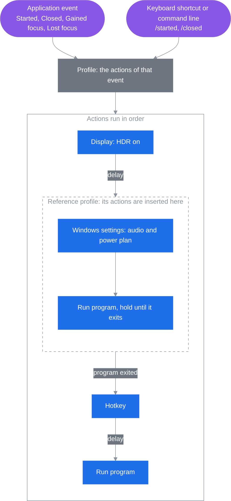
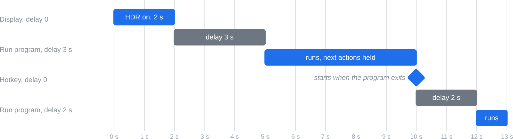

# AutoTrigger: advanced guide

Everything the [README](../README.md) leaves out: what each event and action does, how actions run, the command line, and how AutoTrigger works under the hood.

## Events and actions

An application has four events, each with its own list of actions in its profile:

- **Started** and **Closed**: the program starts and exits.
- **Gained focus** and **Lost focus**: its window comes to the front, then another one does. Use them to change settings only while you are in the game, and set them back when you switch to another window.

The actions, each with its own delay:

- **Display**: HDR, resolution, refresh rate and, on NVIDIA, color depth, format and range. Works with DSR and DLDSR.
- **Windows settings**: default audio output and input devices, power plan, and screen saver on or off.
- **Run program**, with options to hold the next actions until it finishes, to hide the console window of command-line tools and scripts, and not to start a program that is already running.
- **Close program**: asks a program to close, and can force it after a delay (**Force close after**).
- **Hotkey**: presses a keyboard shortcut of another app.
- **Reference profile**: reuses the actions of another profile.

Run program, Close program and Hotkey actions can have a name, shown on the action card and in the log.

A profile can be shared by several applications. Each application has its own monitoring switch, and **Pause** in the tray menu stops them all.

## How actions run

<!-- Diagram sources are in docs/diagrams, rendered to images/ with the Mermaid CLI (mmdc), transparent background, scale 2. -->

An event of an application, a keyboard shortcut or a command picks a profile; the actions of that event then run one after the other.



When each action starts, with the delay set on each one:



- Each action waits for the previous one to finish, then for its own delay: above, Run program starts 3 s after the 2 s display change has ended. With a delay of 0, an action starts as soon as the previous one has finished.
- **Hold next actions until this program finishes** makes the next actions wait for that program to exit, 30 s at most by default (**Stop holding after**). The delay of the next action then counts from the end of the hold.
- **Reference profile** inserts the actions of another profile for the same event, with their delays, as if they were written in its place. References can be nested 8 levels deep.
- When a profile starts, the profiles still running for another application or a keyboard shortcut finish their remaining actions at once, without their delays and holds, then the new profile runs. This waits 10 s at most.

## Full path or file name

Applications are matched by full path. Choose **File name only** when the folder changes over time, such as Game Pass games or programs that update into versioned folders.

## Restart app

Some games read HDR or the resolution only when they start. With **Restart app** on in the profile, once its Started actions are done, AutoTrigger closes the program and starts it again with the same arguments, without running its Closed or Started actions again. It is ignored when the profile runs from a keyboard shortcut or the command line, and a program run as administrator cannot be restarted.

## Launch button and desktop shortcuts

The **Launch button** column, in Applications, sets what the Launch button of the Status page runs: **None**, no button; **Program**, the application's own program; or a profile, whose Started actions run as with its keyboard shortcut. A profile with a **Run program** action can start a game through its launcher. Applications added by hand start with None; imported applications and those of earlier versions start with Program.

Right-click an application on the Status page, then **Create desktop shortcut**: the shortcut runs what its Launch button runs. For **Program**, it opens the program itself; for a profile, it calls `AutoTrigger.exe /launch`, so choosing another profile later needs no new shortcut. Creating it again replaces it; a shortcut of the same name that runs something else is kept, and the new one gets a number.

A shortcut that runs a profile points to AutoTrigger.exe where it is now. If you move AutoTrigger, create the shortcut again: it replaces the one that no longer works.

## Icons

An application shows the icon of its program, and so does its desktop shortcut. For another one, such as when the game's program has no icon but its launcher has, choose **Import...** under **Icon** in the application's window: a PNG, JPEG, BMP or ICO picture, or a program, whose icon is taken. A picture that is not square is centered. AutoTrigger keeps its own copy, so the original can be deleted. **Remove** goes back to the program's icon. A shortcut already on the desktop keeps its old icon until it is created again.

## Profile groups

Groups only sort the Profiles page: they change nothing in how profiles run. In the **Group** field of a profile, choose **New group...** to create one, or an existing group. The **Group** list above the profiles then shows all profiles, one group, or the profiles without a group; the pencil next to it renames the listed group. A profile added while a group is listed goes into that group, a group disappears with its last profile, and the list opens on the last group chosen.

## Keyboard shortcuts and command line

A profile can have two keyboard shortcuts (Ctrl or Alt, with or without Shift, plus a key; F13 to F24 also work alone): **Keyboard shortcut (Started)** runs its **Started** actions and **Keyboard shortcut (Closed)** its **Closed** actions, from anywhere. They also work while monitoring is paused. The Status page lists them all.

| Command | Result |
| --- | --- |
| `AutoTrigger.exe /pause` | Pause monitoring |
| `AutoTrigger.exe /resume` | Resume monitoring |
| `AutoTrigger.exe /toggle` | Pause or resume |
| `AutoTrigger.exe /started "Name"` | Run the Started actions of a profile |
| `AutoTrigger.exe /closed "Name"` | Run the Closed actions of a profile |
| `AutoTrigger.exe /launch <id>` | Run what the Launch button of an application runs; written by desktop shortcuts |

If AutoTrigger is not running, the command starts it and returns only when AutoTrigger exits. Sent to a running AutoTrigger, it returns 0 on success and 1 on failure. An unknown command returns 2.

## Hotkey limits

- One keyboard shortcut per action.
- The window in front receives the keys too.
- Windows blocks keys sent to a window run as administrator; the log names that program.
- If keys are still held down, such as the keyboard shortcut that ran the profile, the action waits up to 1 s for their release.
- No confirmation that the other program reacted; some games and anti-cheat systems ignore simulated keys.

## Moving from AutoActions

In Settings, **Import from AutoActions**, then pick its `UserSettings.json`. Applications, profiles and displays are replaced; the previous AutoTrigger settings are backed up and AutoActions' file is not changed. The summary lists the programs the imported profiles will start. Quit AutoActions afterwards, or every action runs twice. AutoActions shortcuts and the default profile are not imported; an action type AutoTrigger does not know is kept as an unknown action, which does nothing.

## How it works

- **Starts**: the process list is read every 500 ms with `NtQuerySystemInformation`. **Closes**: signaled by Windows. **Focus**: a `WinEvent` hook; a change must last 300 ms. For Windows Store apps, the app inside the `ApplicationFrameHost` frame is used.
- **Display**: resolution with `SetDisplayConfig` and GPU scaling, HDR with `DisplayConfigSetDeviceInfo`, NVIDIA color with NVAPI. Only what differs is changed, and a failed step undoes the previous ones.
- **Windows settings** sets the default audio devices and uses `PowerSetActiveScheme` for the power plan. An audio device is saved by its Windows id; when a driver update or another USB port gives it a new one, the connected device with the same name is used, if no other device has that name. With two identical devices, only one of them connected, the connected one is used. The screen saver is changed for the current session only, and turned back on when AutoTrigger exits.
- **Hotkey** uses `SendInput`. Keyboard shortcuts use `RegisterHotKey`. The command line talks to the running AutoTrigger through a local named pipe open to the current user only.
- **Close program** asks the program's windows to close, its hidden ones when none is visible, as `taskkill` does without `/F`. With **Force close after**, it ends the program once the delay is over.
- Settings are in `%LOCALAPPDATA%\AutoTrigger\settings.json`, written atomically, and imported icons in its `custom-icons` folder. Start with Windows uses the current user's `Run` key.
- **Update check**: one HTTPS request to the GitHub API, shortly after start and then every 4 h by default, reads the number of the latest release. A new version shows as a link at the bottom of the window and a dot on the tray icon. Nothing is downloaded, installed or sent. With **Check for updates** off in Settings, AutoTrigger doesn't use the network.

How the code is organized: [ARCHITECTURE.md](ARCHITECTURE.md).

## Build

Visual Studio 2026 with the **.NET desktop development** workload, from a Developer Command Prompt:

```
msbuild AutoTrigger.sln -restore -p:Configuration=Release
```

The program is written to `out\Release`. [WPF UI](https://github.com/lepoco/wpfui) 4.3.0 is downloaded from NuGet on the first build. The tests are written to `out\Tests`: run `AutoTrigger.Tests.exe`, exit code 0 means they all passed. GitHub builds and tests every change.
